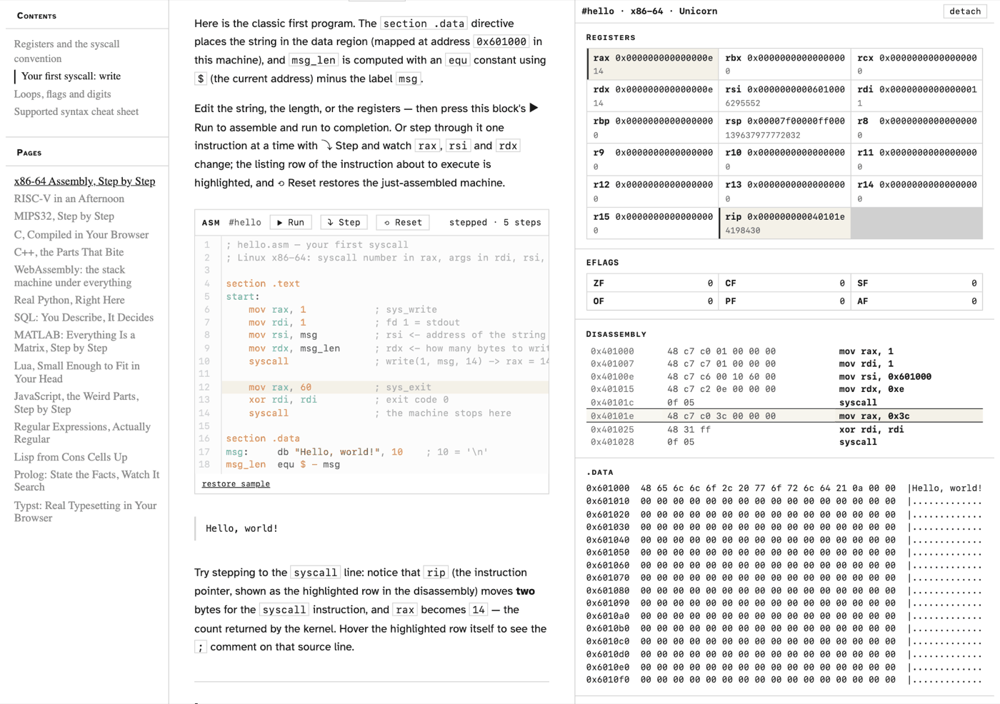

# didact

A client-side literate-programming site framework. Drop `.org` files in and
get a site where prose interleaves with executable, steppable code blocks;
each block drives an under-the-hood machine panel — registers, disassembly,
memory, console; a disassembly row shows its source line's `;` comment on
hover. Fifteen kernels ship out of the box: x86-64, RV32IM, MIPS32, C,
C++, WebAssembly, Python, SQL, MATLAB, Lua, JavaScript, regex, Lisp,
Prolog, and Typst. No server, no runtime network beyond
same-origin vendor assets: parsing, assembly, execution, and stepping are
all client-side.

## What it looks like

Every block is real: assemble, step, and watch the machine. Below, the
first x86-64 syscall block five steps in — registers that changed since the
last step are tinted, the disassembly row about to execute is highlighted,
and the console shows the bytes `write` just emitted.



The same right-rail panel hosts a different machine per kernel.

| regex: Thompson NFA mid-match | SQL: one `SELECT` under the plan panel |
| --- | --- |
|  |  |

More demos — a loop mid-iteration, RISC-V, MIPS `mult`, the Lisp
cons-heap, and MATLAB's column-major memory — live in
[`docs/showcase/`](docs/showcase/).

## Quickstart

```sh
pnpm install
pnpm dev
```

Open the printed URL. (If pnpm blocks esbuild's install script, run
`pnpm approve-builds --all -y` once.)

`pnpm build` emits a fully static site to `apps/site/dist` — `base` is
`'./'`, so it hosts anywhere, at any path. `pnpm preview` checks the build.

## Kernels

| id | label | editor syntax | package | vendor assets |
| --- | --- | --- | --- | --- |
| `asm` | x86-64 · Unicorn | `asm-intel` | `packages/kernel-asm64` | `public/vendor/` (~8.6 MB, unicorn/keystone/capstone wasm) |
| `riscv` | RV32IM · interpreter | `asm-riscv` | `packages/kernel-riscv` | none (pure TypeScript CPU) |
| `mips` | MIPS32 · interpreter | `asm-mips` | `packages/kernel-mips` | none (pure TypeScript CPU) |
| `c` | C · clang wasm | `c` | `packages/kernel-c` | `public/vendor-c/` (~105 MB, clang → wasm32-wasi) |
| `cpp` | C++ · clang wasm | `cpp` | `packages/kernel-cpp` | shares `public/vendor-c/` with `c` (same clang engine) |
| `python` | Python · Pyodide | `python` | `packages/kernel-python` | `public/vendor-python/` (~13 MB, CPython 3.14 wasm) |
| `wasm` | WebAssembly · interpreter | `scheme` | `packages/kernel-wasm` | none (pure TypeScript interpreter) |
| `sql` | SQL · query engine | `sql` | `packages/kernel-sql` | none (pure TypeScript engine) |
| `matlab` | MATLAB · interpreter | `octave` | `packages/kernel-matlab` | none (pure TypeScript interpreter) |
| `lua` | Lua · interpreter | `lua` | `packages/kernel-lua` | none (pure TypeScript interpreter) |
| `javascript` | JavaScript · interpreter | `javascript` | `packages/kernel-javascript` | none (pure TypeScript interpreter) |
| `regex` | Regex · NFA engine | `plain` | `packages/kernel-regex` | none (pure TypeScript Thompson NFA) |
| `lisp` | Lisp · interpreter | `scheme` | `packages/kernel-lisp` | none (pure TypeScript interpreter) |
| `prolog` | Prolog · interpreter | `plain` | `packages/kernel-prolog` | none (pure TypeScript SLD engine) |
| `typst` | Typst · wasm | `plain` | `packages/kernel-typst` | `public/vendor-typst/` (~25 MB, compiler wasm + fonts) |

Engine payloads are npm dependencies pinned by `pnpm-lock.yaml`;
`scripts/sync-vendors.mjs` copies them into `public/` at build time — the
repository itself is source-only.

## Authoring a page

Drop your `.org` file into `apps/site/src/pages/` and add its file stem to
the `PAGE_ORDER` array in `apps/site/src/main.ts` — the file appears in the
nav at that position, titled from its `#+TITLE:` (file stem as fallback).
A `.org` file in `pages/` that is missing from `PAGE_ORDER` logs a console
warning and is skipped; if `PAGE_ORDER` names a file that doesn't exist,
that also warns and is skipped; the site only fails hard when no pages
resolve at all. A block is executable when its `#+BEGIN_SRC <lang>`
language matches a registered kernel; other languages render read-only.

```org
#+TITLE: Hello, registers
#+SUBTITLE: one instruction at a time

The =mov= instruction copies a value into a register.

* Try it

Step through this block and watch =rax= change:

#+NAME: hello
#+BEGIN_SRC asm
; put a value in rax, then exit cleanly
mov rax, 42
mov rax, 60
mov rdi, 0
syscall
#+END_SRC

#+RESULTS:
```

Output replaces the block's `#+RESULTS:` slot when it runs. Lessons stay
valid org-babel documents in Emacs; the full grammar (headings, `#+NAME:`,
markup, lists, tables) is in [`docs/design.md`](docs/design.md).

## Adding a kernel

Follow the recipe in [`AGENTS.md`](AGENTS.md) — package layout, vendored
wasm assets, and registration in `apps/site`. The Kernel/Session/Panel
contract those steps implement is specified in
[`docs/architecture.md`](docs/architecture.md) and
[`packages/core/src/kernel.ts`](packages/core/src/kernel.ts).

## Deploy to GitHub Pages

The repo ships [`.github/workflows/deploy.yml`](.github/workflows/deploy.yml),
which builds and publishes the site on every push to `main`. One-time
setup: repo Settings → Pages → Build and deployment → Source:
**GitHub Actions**. The site then lives at
`https://<owner>.github.io/didact/`; no other config needed.

## Tests & quality

- `pnpm test` — vitest suite plus kernel smoke scripts (the smokes need
  [bun](https://bun.sh) on PATH)
- `pnpm lint` — eslint across the repo
- `pnpm typecheck` — `tsc --noEmit` covering all packages
